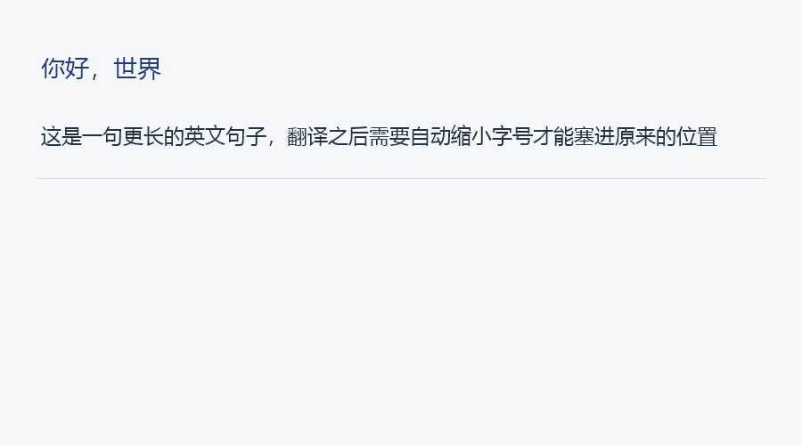
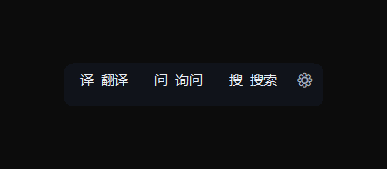
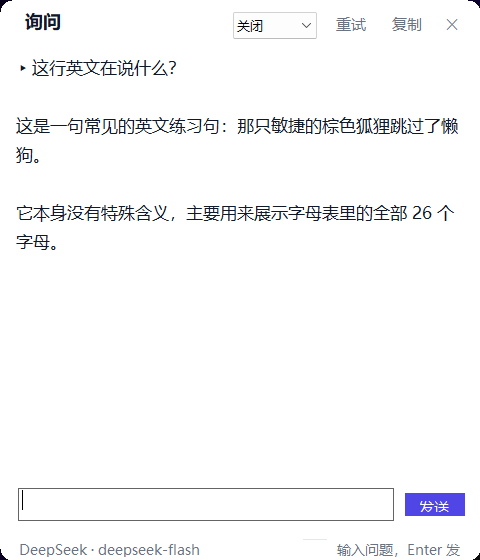
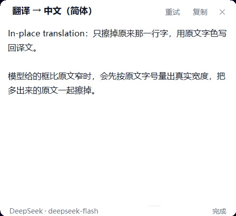
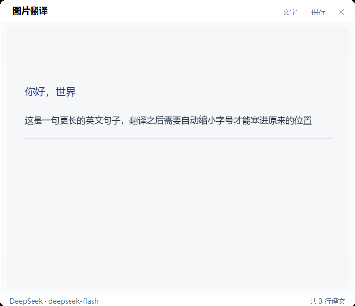
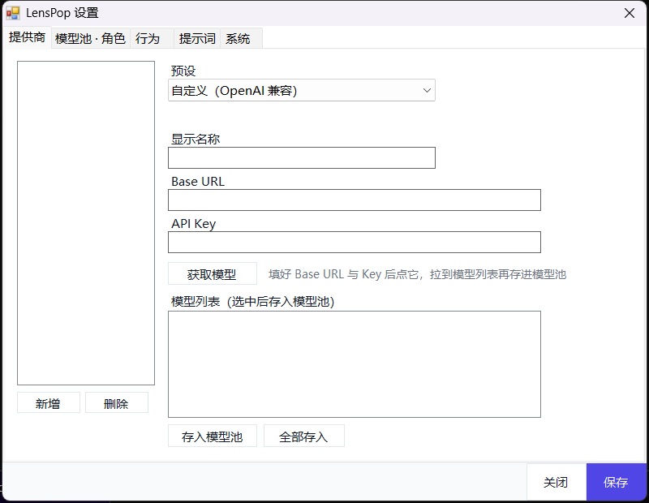

# LensPop · 划词透镜

> 划词即译、即问、即搜；右键图片识别文字，图片翻译会把译文**贴回原图**。
> Windows 单文件绿色版：下载一个 exe，双击就能用，不用装运行时、不用装浏览器扩展。




*上图是自测用例：原文（英文）被按原字号、原位置、原文字色换成中文；空间不够就自动缩小字号，不往空白区域乱扩。*

## 长什么样

| 划词后的小胶囊 | 询问（右上角可选思考档位） |
| --- | --- |
|  |  |

| 翻译结果窗 | 图片翻译结果窗 |
| --- | --- |
|  |  |

设置窗口（提供商 / 模型池 · 角色 / 行为 / 提示词 / 系统）：



---

## 它能干什么

| 场景 | 操作 | 结果 |
| --- | --- | --- |
| 翻译选中文字 | 在任意软件里划词 → 点「译 翻译」 | 鼠标旁弹出结果窗，流式出译文 |
| 就选中的内容提问 | 划词 → 点「问 询问」 | 弹窗里输入问题，可切换**思考档位** |
| 搜索选中文字 | 划词 → 点「搜 搜索」 | 用系统默认浏览器打开搜索页 |
| 识别图片文字 | 在图片文件上右键 → LensPop 识别文字 | 弹出识别结果，可复制 |
| 翻译图片并贴回原图 | 在图片文件上右键 → LensPop 翻译图片 | 生成一张「译文在原位」的新图 |
| 识别 / 翻译屏幕区域 | 快捷键框选 → 自动识别或翻译 | 同上 |
| 识别 / 翻译剪贴板图片 | 托盘菜单或快捷键 | 同上 |

划词不挑软件：浏览器、PDF 阅读器、微信、Office、记事本都行。

## 为什么这么小

- 单个 `LensPop.exe`，约 140 KB，绿色免安装，删掉即卸载。
- 只用 Windows 自带的 .NET Framework 4.8（Win10 1903+ / Win11 默认就有），**不打包运行时**。
- 无 Electron、无 WebView2、无 Node、无后台服务，托盘里一个图标。
- 所有 AI 请求由本机直连你自己填的 API，不经过任何中间服务器。

## 下载与安装

1. 到 Releases 下载 `LensPop-1.0.0-win.zip`，解压得到 `LensPop.exe`。
2. 双击运行，托盘出现紫色放大镜图标（第一次可右键托盘 → 设置）。
3. 想用图片右键菜单：设置 → 系统 → 注册（只写当前用户注册表，不需要管理员）。

> 未签名 exe 可能被 SmartScreen 提示，点「更多信息 → 仍要运行」即可。源码就在本仓库，可自行 `build.cmd` 编译。

## 第一次配置（三步）

1. **提供商**：设置 → 提供商 → 新增 → 选预设（DeepSeek / Kimi / GLM / 通义 / 硅基流动 / OpenRouter / 豆包 / OpenAI / Gemini / Ollama / 自定义）→ 填 Base URL 和 API Key。
2. **获取模型**：点「获取模型」，列表出来后点一个 →「存入模型池」（也可全部存入）。模型名不在列表里可以手填。
3. **选角色**：设置 → 模型池 · 角色 → 分别选
   - 翻译模型（便宜的快模型即可）
   - OCR 模型（**必须能读图**：名字里常带 `vl` / `vision` / `4v`，列表里会标「可读图」）
   - 询问模型（留空则复用翻译模型）

内置预设都走 OpenAI 兼容协议（`GET {base}/models`、`POST {base}/chat/completions`），中转站、自建网关也能填。

## 思考档位：翻译 / OCR 从不思考

思考很拖时间，所以：

- **翻译、OCR、图片翻译**：一律显式关闭思考（`thinking.type=disabled` / `reasoning_effort=none` / `enable_thinking=false`，按模型家族自动挑参数）。
- **询问**：结果窗右上角有「思考」下拉，默认**关闭**；想让它多想一会儿就在提问前切一档。

各家的档位都按官方参数适配过（聚合类不做猜测）：

| 模型家族 | 可用档位 | 关掉思考的写法 |
| --- | --- | --- |
| DeepSeek（deepseek-flash / v4-pro …） | 默认 / 关闭 / 低 / 高 / 最高 | `thinking.type=disabled` + `reasoning_effort=none` |
| Kimi K3 / K3.1 Pro | 默认 / 低 / 高 / 最高 | 关不掉，只能 `reasoning_effort=low` |
| GLM-5.x | 默认 / 低 / 高 / 最高 | 关不掉，只能 `reasoning_effort=low` |
| GLM-4.x | 默认 / 关闭 / 开启 | `thinking.type=disabled` |
| 通义千问 Qwen3 | 默认 / 关闭 / 开启 | `enable_thinking=false` |
| OpenAI GPT-5 / o 系列 | 默认 / 极简 / 低 / 中 / 高 | `reasoning_effort=minimal` |
| Gemini | 默认 / 极简 / 低 / 中 / 高 | `reasoning_effort=minimal` |
| 豆包 Seed | 默认 / 关闭 / 低 / 高 | `thinking.type=disabled` |
| OpenRouter / 硅基流动 / 自定义 / Ollama | 只有「默认」 | 不发参数，用模型自己的默认 |

服务端若不认这些参数（返回 400/422），客户端会自动去掉思考参数重试一次，不会把请求打挂。

## 图片翻译是怎么「贴回去」的

1. 视觉模型返回每一行文字的框、颜色和原文（JSON）。
2. 翻译模型把整批行文本翻成目标语言（一次请求，顺序一一对应）。
3. 在本机用 GDI+ 处理：
   - 只擦掉**原来那一行字**所占的区域，不往旁边扩、不开空白区；
   - 用原图底色填充，用**原文字的颜色**绘制译文；
   - 字号从原高度往下收，收到底还放不下就按最小字号直接替换原文；
   - 模型给的框比原文窄时，先按原文字号量出真实宽度，把多出来的原文一起擦掉，避免留下「半截单词」。

结果窗里可以「保存图片」「文字对照」，点图可看大图。

## 快捷键与托盘

| 动作 | 默认 |
| --- | --- |
| 识别剪贴板图片 | `Ctrl+Alt+O` |
| 框选屏幕区域识别 | `Ctrl+Alt+S` |

托盘菜单：设置 / 划词弹窗开关 / 识别·翻译剪贴板图片 / 截图识别·翻译 / 打开配置目录 / 退出。
快捷键、开机自启、右键菜单注册都在「设置 → 系统」里。

## 数据与隐私

- API Key、模型池、提示词存在 `%APPDATA%\LensPop\config.json`（**明文**，和大多数本地工具一样；别把这个文件传给别人）。
- 请求只发往你自己配置的 Base URL；没有遥测、没有统计、没有云端账户。
- 图片会先缩到最长边 1600px 再上传，省 token 也省流量。

## 已知限制

- **划词靠模拟一次 `Ctrl+C`** 读取选中内容，所以会临时改写剪贴板（大多数划词工具都这样）。终端里 `Ctrl+C` 是中断信号，别在终端里划词。
- 少数以管理员权限运行的窗口，普通权限的 LensPop 抓不到钩子/热键；需要的话用管理员身份运行。
- 图片右键菜单是资源管理器菜单；网页里的图片请用「截图识别」（`Ctrl+Alt+S` 框选）。
- 全屏独占游戏、受保护视频画面上取不到像素。
- OCR 模型必须支持读图；纯文本模型（如 `deepseek-flash`）只能当翻译/询问模型。

## 开发与构建

不需要 Visual Studio，也不需要 .NET SDK，用系统自带的 C# 编译器即可：

```bat
build.cmd
```

产物 `dist\LensPop.exe`（.NET Framework 4.8 / C# 5 语法，Win10+ 直接跑）。

自测（假 API 服务 + 出图验证，不需要真实 Key）：

```bat
dev-test.cmd
dist\test-harness.exe
```

会打印模型列表/流式解析结果、思考档位映射，并生成 `dist\test-compose.png` 供肉眼检查排版。

### 目录结构

```
src/Config.cs          配置模型（JSON 读写、角色解析）
src/Providers.cs       内置提供商预设
src/Thinking.cs        思考档位适配（各家参数）
src/Api.cs             OpenAI 兼容客户端（/models、SSE 流式）
src/ImageTools.cs      取图/缩放/布局 JSON 解析/译文排版
src/MouseHook.cs       全局鼠标钩子 + Ctrl+C 取词
src/CaptureForm.cs     框选截图
src/PopupForm.cs       划词小胶囊
src/ResultForm.cs      翻译 / 询问结果窗（流式）
src/ImageResultForm.cs 图片翻译结果窗
src/SettingsForm.cs    设置窗口
src/ShellMenu.cs       资源管理器右键菜单
src/Program.cs         托盘、热键、图片流水线
```

## License

MIT © 2025 lnrh1
